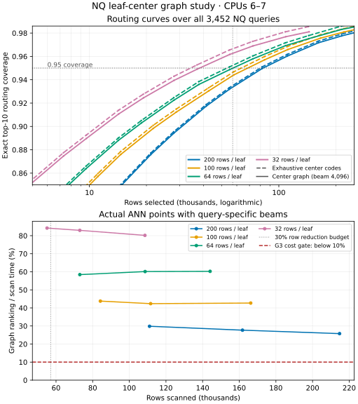

# G2: smaller leaves and a graph over leaf centers

I ran an offline study of the G2 proposal in `graph-index.md`, against main at `13ffada`. I changed no
production code, query path, or stored format.

## Decision

I do not recommend G3 from this study. Smaller leaves reduce rows scanned, but this degree-16 graph
costs far more than the gate of 10% of scan time. I would improve and remeasure the center search before
changing the directory format.

I found a separate assignment opportunity worth a full-pipeline follow-up. At the 100M-shaped cell size,
one-bit graph navigation with 64 exact candidates is 1.59× faster for one fixed-center pass, including
construction, with routing coverage 0.94942 → 0.94884 and 2.7% more rows selected.

I use the lowest measured row count with actual recall@10 at least 0.95 in this summary. I do not
interpolate between probe counts. All measurements use all 3,452 queries.

| Target leaf rows | Exhaustive-code recall / rows | Graph recall / rows | Graph ranking / scan | Graph row reduction vs best measured 200-row point |
|---:|---:|---:|---:|---:|
| 200 | 0.9509 / 81,561 | 0.9601 / 111,032 | 29.8% | -36.1% |
| 100 | 0.9597 / 83,948 | 0.9564 / 84,196 | 43.8% | -3.2% |
| 64 | 0.9510 / 54,907 | 0.9568 / 72,987 | 58.4% | +10.5% |
| 32 | 0.9526 / 36,957 | 0.9608 / 55,094 | 84.2% | +32.5% |

I measured 32.7% fewer rows with 64-row leaves and exhaustive code ranking at essentially the same
recall: 0.95096 versus 0.95093. With the graph, the 64-row layout scans 34.1% fewer rows than the
current 524-probe baseline (0.9616 recall, 110,773 rows), but ranking costs 58.4% of scan time. The
32-row graph also clears the row-reduction gate against the better 200-row point, while ranking costs
84.2% of scanning. Either baseline leaves the CPU gate unmet.

I measured fewer center evaluations with the graph, but each visited center is much more expensive
overall. At 64-row leaves and 1,024 probes, exhaustive code ranking scores 41,880 centers in 1.38 ms;
the graph visits 8,856 in 2.63 ms. I infer that traversal and candidate maintenance outweigh the saved
score evaluations in this prototype. This is not a kernel profile. As leaves shrink, the query returns
more leaves and visits roughly eight or nine centers per returned leaf, so ranking grows as a share of
scan time.

I also measured that fewer logical rows do not guarantee proportional scan CPU savings. The 32-row graph
scans 55,094 rows in 5.02 ms, against 81,561 rows in 4.57 ms for the qualifying 200-row exhaustive-code
point. I did not isolate per-leaf setup from fast-scan block padding. The gate here uses the full
resident-code scan API, including that work; a kernel-only denominator would be stricter.



I connect measured points as visual guides. The vertical line is 57,092 rows, 70% of the best measured
200-row point. The upper panel uses routing coverage with graph beam 4,096; the lower panel uses actual
ANN timings with search beam twice the probes. I use no interpolation for the gate.

## Method

I used the BEIR NQ harness's full 2,681,468-row, 1,024-dimension f16 corpus, its 3,452 test queries, and
its exact cosine top-100 truth. I measured recall against the exact top 10, not the relevance judgments.
I generated the arrays and truth with `bench/nq/prepare.py`.

I pinned the study to CPUs 6 and 7, limited Rayon to two threads, and built with
`nice -n 19 cargo ... -j 2`. Build and assignment times are two-core wall times. My graph builder is
serial. Each query's ranking and scan run on one thread. Another worker used CPUs 0–5 for throughput
measurements; I did not run a server, access a bucket, or signal the production service.

I copied the current cross-cell trainer and blocked assignment into the example, preserving its
sampling, seeds, four nearby cells, 12 groups, four-row blocks, and one refinement pass. I used 32
coarse recluster cells for the leaf-size comparison, and eight for the assignment comparison. I
preserved the 1,024-leaf threshold for two-level training, so the finer layouts include that existing
automatic training choice. I distinguish these large recluster cells from the paged directory's
approximately 24-entry cells: they are different partitions.

I built a single-layer HNSW-style graph with shuffled insertion order (seed 7), construction beam 64, a
maximum out-degree of 16, reciprocal insertion, diversified neighbor selection, and filling spare slots
from rejected candidates. I used exact squared Euclidean distances between prepared leaf centers for
construction. I followed the insertion and neighbor-selection approach described by Malkov and Yashunin,
without HNSW's upper layers:

https://arxiv.org/abs/1603.09320

I compared exhaustive exact-f32 center ranking, exhaustive one-bit center-code ranking, and beam search
using the same one-bit center scoring as production. The example includes the production RaBitQ module
directly, rather than adding a public API. A test compares its center scores with
`Directory::center_distances_on`. I used a single global graph entry for warm queries and assignment,
rather than coarse-cell seed selection. I used a beam of twice the requested leaves for the actual ANN
measurements.

I first measured routing coverage: the fraction of exact top-10 rows whose assigned leaves were
selected. This assumes perfect scoring within the selected leaves and is an upper bound on ANN recall. I
then measured actual RaBitQ scan and exact rerank at the first coverage point at or above 0.95 and the
next two measured probe counts. I kept 320 rerank candidates for a top-10 query. I report measured probe
counts, without interpolating between them. These are absolute leaf counts, rather than the API's scaled
`ann_nprobe` parameter. The full-curve graph search uses a beam of 4,096; I use the smaller,
query-specific beam and its measured recall and timings for the gate. Curve ranking times therefore
describe that diagnostic beam, not the smaller beam used for ANN validation.

I exclude the separately computed query rotation from scan timing. Center-code ranking includes its
rotation and query setup. I retained that common code setup in the actual ANN exact-f32 control too; the
routing-curve exact-f32 timer measures only full-precision ranking.

I built pages with the existing `Directory::build_paged(24, 7, ...)`, even below the current
100,000-entry paging threshold. I kept trained centers in the graph and excluded zero-row leaves from
query selection. I treated edges to zero-row leaves as unavailable, since those leaves have no directory
entry. I counted directed edges leaving their source page, and edges from selected leaves to pages
outside the fetched set. For page-restricted search I used the current
`select_cells(query, 16 * probes, 0.5)` selection, seeded each fetched page with its first two live
entries, and skipped every edge outside the fetched pages. I included header selection, seed setup, and
center-code query setup in this ranking cost. No graph hop reads an object. I report current
paged-object bytes, excluding the in-memory graph adjacency.

I use the eight-cell runs only for the assignment experiment. I ran one-bit navigation and
full-precision navigation as separate paired experiments, retraining the current baseline with the same
seeds for each run. During recluster, the full-precision centers are already in RAM. The `exact` CLI
mode uses full-precision distances to navigate the graph; its search remains approximate.

For assignment, I froze the baseline's final centers and searched the global graph for each corpus row,
rather than restricting candidates to the four nearest coarse cells. I restricted eligible destinations
to leaves that were nonempty in the baseline layout. With one-bit navigation, I used 8, 16, 32, and 64
candidates, search beams twice those counts, and exact ranking of the returned candidates. With
full-precision navigation, I used search beams 4, 8, 16, and 32 and selected the closest reached center.
I cached frozen one-bit query rankings for coverage checks at 256 through 8,192 probes, outside the
timed assignment pass. I kept the same query ordering for both scorers to isolate assignment quality.

I measured one assignment pass, including corpus file reads, row decoding and normalization, navigation,
and exact candidate ranking where needed. One-bit navigation also includes center-code query
preparation. The timer includes one extra exact comparison with the baseline center per row for
diagnostics; graph construction and code encoding are separate. Full-precision navigation needs no code
encoding for assignment; I encoded codes only for its untimed query-coverage diagnostic. I counted a
distance as no worse when it was at most the baseline plus `1e-6`. I compared its assigned leaf with
the current blocked assignment on those same centers, its distance with the baseline's distance, and
top-10 query-neighbor coverage under the two partitions. The blocked baseline reads in group order
during its distance pass; graph assignment reads in row-ID order. I did not separate those ordering
effects on I/O from center-distance CPU. I did not validate an entire graph-based training and
refinement loop.

## Assignment result

I see an assignment opportunity separate from G3. The following points use all 2,681,468 rows and all
3,452 queries. I compare one final assignment pass on frozen centers, and include graph construction
once in the speedup. For one-bit navigation, I also include code encoding. For full-precision
navigation, code encoding is only an untimed coverage diagnostic, so I exclude it from the speedup.

| Target leaf rows | Navigation / budget | Baseline pass s | Graph build + encoding s | Graph pass s | Speedup including build | Coverage baseline → graph | Rows baseline → graph |
|---:|---|---:|---:|---:|---:|---:|---:|
| 200 | one-bit candidates 16 | 122.71 | 3.03 | 71.55 | 1.65× | 0.95855 → 0.95826 | 113,050 → 114,464 |
| 21 | one-bit candidates 8 | 521.09 | 55.46 | 87.96 | 3.63× | 0.94942 → 0.92993 | 26,427 → 30,762 |
| 21 | one-bit candidates 32 | 521.09 | 55.46 | 174.09 | 2.27× | 0.94942 → 0.94676 | 26,427 → 27,721 |
| 21 | one-bit candidates 64 | 521.09 | 55.46 | 272.27 | 1.59× | 0.94942 → 0.94884 | 26,427 → 27,132 |
| 200 | f32 beam 32 | 131.39 | 3.02 | 114.37 | 1.12× | 0.95855 → 0.95843 | 113,050 → 114,316 |
| 21 | f32 beam 32 | 1073.32 | 61.31 | 263.73 | 3.30× | 0.94942 → 0.94287 | 26,427 → 28,629 |

I used 21-row leaves to reproduce the 100M-sized cell shape: 127,686 centers in eight cells, with about
4,050 center comparisons per row in the current final assignment. With one-bit navigation and 64 exact
candidates, I reduced a 521.09-second pass to 272.27 seconds, or 1.59× faster after the 55.46-second
graph build and code encoding. Frozen-center query routing coverage at 1,024 probes changed from 0.94942
to 0.94884, a loss of 0.00058 (0.058 percentage points), and rows selected grew 2.7%. I matched the
current assigned leaf for 97.72% of rows, found a no-worse exact distance for 98.36%, and measured a
total squared-distance ratio of 1.00628. The baseline is just below 0.95 at 1,024 probes; at 2,048
probes, coverage changes from 0.96932 to 0.96883. I do not call these actual ANN recall measurements.

I found faster, lower-quality points too: eight candidates are 3.63× faster including construction, but
lose 1.95 percentage points of coverage and select 16.4% more rows at 1,024 probes. I would not replace
the group stage from timing alone. I would first validate a complete graph-based training, mean update,
refinement, and ANN run. I would rebuild or validate the graph after centers move, and count that cost.
The current graph is built after the baseline refinement, so these speedups are for one fixed-center
pass, rather than the whole recluster job.

I also measured full-precision navigation, since recluster already holds f32 centers. At the large
shape, beam 32 takes 263.73 seconds plus 61.31 seconds of construction, against its own 1,073.32-second
baseline pass: 3.30× faster in that paired run. It matches the current leaf for 94.41% of rows and finds
a no-worse distance for 94.90%. Coverage at 1,024 probes changes from 0.94942 to 0.94287, a loss of
0.655 percentage points, and selected rows grow 8.3%. I measured lower coverage loss with the one-bit
64-candidate point. I did not interleave these scorers, and their baselines saw different filesystem
behavior, so I would not read the paired speedup difference as a precision-only CPU gain. The
full-precision 4-, 8-, and 16-beam points lose still more coverage; higher precision does not make a
short search sufficiently accurate in this graph.

## Page-boundary result

I found that 64.2–66.0% of directed graph edges leave their source page. The fetched set contains many
pages, so only 2.2–5.6% of edges from the selected leaves are unavailable near the qualifying query
points. I count unavailable edges from selected leaves, rather than every edge examined during search.
Page-restricted recall is 0.0006–0.0026 below warm graph recall at those same probe counts. Its ranking
cost is 30.8–85.6% of scan time, so the page restriction does not rescue the CPU gate. I simulated these
restrictions in RAM and measured no object-store reads or latency.

## Limits

I measured one full quality sweep per layout and a discrete probe grid. My no-go applies to this
construction and beam rule; I would require a new measured gate before a format change. I did not
optimize each method to the minimum possible probe count at exactly 0.95. I used `Vec<Vec<usize>>`
adjacency and standard-library heaps; I did not measure a compact u32 layout, batched neighbor scoring,
or an optimized frontier. I report mean per-query wall times from these sweeps, without confidence
intervals. I did not interleave the two assignment scorers. The full-precision run's large first
baseline pass took 876.47 seconds, against 519.78 seconds in the one-bit run. Its final pass took
1,073.32 seconds, against 521.09 seconds. I observed filesystem waits during the slower run. I use each
run's own baseline and do not treat cross-run timing differences as a CPU profile.

I used resident arrays to simulate page restrictions. I did not measure S3 latency, final directory
memory usage, or full server throughput. I materialized one index per coarse cell for the query study,
rather than exercising the production slab-size limit and streaming build. The query matrix peaked at
10.43 GiB RSS; I did not validate the production memory budget with this offline example.

I used eight cells with 21 target rows per leaf to reproduce approximately 16,000 leaf centers per cell,
as a proxy for the 100M job's assignment shape. I did not run a 100M-row corpus. A larger corpus also
has more total centers in its global graph, even at the same per-cell shape; I would not transfer these
per-row graph timings directly to 100M. I held centers and query leaf ordering fixed for the assignment
comparison; a full graph-based assignment, mean update, refinement, and ANN validation remain a
follow-up.

## Reproduction

The study code is not in `main`: it copies a frozen production baseline that would drift. It lives on the
[`study/graph-g2`](https://github.com/endgame-labs/blowfish/tree/study/graph-g2) branch (commit `7fac0af`), and the
paths below refer to that branch.

I added `crates/bf-engine/examples/graph_study.rs`, with study-only graph and baseline helpers. I added
the workspace's existing pinned `proptest` version as a development dependency so the included scorer's
property tests can compile in the example. The generated lockfile change only links that existing
package to `bf-engine`. The CLI accepts a data directory, a new temporary run directory, a query count
(default all queries), comma-separated target leaf sizes, a coarse cell count, and an assignment scorer
(`codes`, `exact`, or `both` ; default `codes` ). It selects evenly spaced queries when given a smaller
count and removes its run directory on ordinary completion, errors, or unwinding. I used an outer
cleanup trap for timeout cleanup.

```sh
source ~/.cargo/env
set -euo pipefail
mkdir -p .scratch/nq-data .scratch/logs .scratch/tmp
cleanup() {
  uv run --no-project python -c \
    'import shutil; shutil.rmtree(".scratch", ignore_errors=True)'
}
trap cleanup EXIT
export TMPDIR="$PWD/.scratch/tmp"
export CARGO_TARGET_DIR="$PWD/.scratch/target"
export UV_CACHE_DIR="$PWD/.scratch/uv-cache"
export UV_PROJECT_ENVIRONMENT="$PWD/.scratch/venv"
timeout 1800 taskset -c 6,7 bash bench/nq/download.sh "$PWD/.scratch/nq-data"
timeout 5400 taskset -c 6,7 env OPENBLAS_NUM_THREADS=2 OMP_NUM_THREADS=2 \
  uv run --project bench/nq python -I bench/nq/prepare.py .scratch/nq-data
timeout 1800 taskset -c 6,7 nice -n 19 cargo build --release -j 2 \
  -p bf-engine --example graph_study
timeout 14400 taskset -c 6,7 .scratch/target/release/examples/graph_study \
  .scratch/nq-data .scratch/leaves 3452 200,100,64,32 32 > .scratch/logs/leaves.csv
timeout 14400 taskset -c 6,7 .scratch/target/release/examples/graph_study \
  .scratch/nq-data .scratch/assignment 3452 200,21 8 > .scratch/logs/assignment.csv
timeout 14400 taskset -c 6,7 .scratch/target/release/examples/graph_study \
  .scratch/nq-data .scratch/assignment-f32 3452 200,21 8 exact > .scratch/logs/assignment-f32.csv
cat .scratch/logs/leaves.csv .scratch/logs/assignment.csv .scratch/logs/assignment-f32.csv
```

I emit CSV records prefixed `COARSE`, `BASE_ASSIGN`, `LAYOUT`, `GRAPH`, `CODES`, `SCANNER`,
`CURVE`, `ANN`, `PAGES`, `ASSIGN`, `ASSIGN_COVERAGE`, `ASSIGN_F32`, and `ASSIGN_F32_COVERAGE`.
`CURVE` records carry cells, target leaf rows, method, probes, routing coverage, mean rows scanned, mean
centers visited, mean ranking ns, and unavailable-edge fraction. `ANN` replaces coverage with actual
recall and ends with ranking ns, scan ns, rerank ns, and ranking/scan. `PAGES` carries page count,
directed edge count, cross-page edge count, cross-page fraction, and paged-object bytes. `ASSIGN`
carries exact candidate count (search beam twice that), seconds, leaf agreement, fraction no worse in
distance, centers visited per row, and total squared-distance ratio. `ASSIGN_COVERAGE` carries exact
candidate count, probes, baseline coverage, graph-assignment coverage, baseline rows scanned, and
graph-assignment rows scanned. The `ASSIGN_F32` variants use the actual search beam in place of the
exact candidate count; their other columns have the same meaning.

I recorded SHA-256 hashes of the generated inputs:

| File | SHA-256 |
|---|---|
| `corpus.f16` | `b1f1fb5d2d49dad476e3f0419ae3ea2975f907ddff94e447133e868ba31be185` |
| `queries.npy` | `841a621c983f0299d60873ee976990806f5d01e20116516f7bdc9842f4be2aaf` |
| `truth.npy` | `fa470968ca6bf216a02ff0995881b07df055d06ca5a5780c7edb16769fb3c1b9` |

## Validation and run resources

I passed `cargo fmt --all -- --check`, `cargo clippy -p bf-engine --all-targets -- -D warnings`,
`cargo test -p bf-engine` (107 tests), and `cargo test -p bf-engine --example graph_study` (seven
tests). I pinned checks to CPUs 6 and 7, and used nice 19 with two build jobs. The example tests cover
graph edge bounds and search, page restrictions, production-equivalent center scores, SIMD scoring,
error bounds, and full-scan truth on a synthetic matrix. I also passed CLI fixtures for the query
matrix, assignment-only mode, and both assignment scorers, including every candidate budget and coverage
probe.

I audited all 48 ANN points, 208 routing points, eight one-bit assignment points, eight full-precision
assignment points, and 96 assignment coverage points. I checked the paired baseline coverage and rows,
ratio calculations, table completeness, and the standalone SVG. I measured the following whole-run
resources with `/usr/bin/time -v` ; these include untimed diagnostics and setup as well as timed passes.

| Run | Wall time | Peak RSS GiB | Exit status |
|---|---:|---:|---:|
| Four query layouts | 1:36:45 | 10.43 | 0 |
| Eight-cell one-bit assignment | 44:35.72 | 2.18 | 0 |
| Eight-cell full-precision assignment | 57:50.81 | 2.18 | 0 |

I copied the measurements into this document before removing the scratch corpus, build outputs, logs,
and test files. I created no bucket prefix or namespace, started no server, and sent no signal to the
production service. I verified that `.scratch` was absent after cleanup.

## Results

I recorded the following completed measurements. I measured these wall times with CPUs 6 and 7
available.

### Actual ANN points

I measured resident-code scan calls, including per-slab setup, allocations, and candidate bounds. I
measured file-backed exact rerank separately; I exclude it from the ranking/scan gate.

| Cells | Target leaf rows | Ranking | Probes | Recall@10 | Rows scanned | Centers visited | Rank ns/query | Scan ns/query | Rank / scan |
|---:|---:|---|---:|---:|---:|---:|---:|---:|---:|
| 32 | 200 | exact-f32 | 384 | 0.953534 | 81,705 | 13,390 | 7,257,228 | 6,552,135 | 110.8% |
| 32 | 200 | exact-f32 | 524 | 0.963934 | 110,948 | 13,390 | 7,462,080 | 8,353,995 | 89.3% |
| 32 | 200 | exact-f32 | 768 | 0.973899 | 161,753 | 13,390 | 6,260,442 | 9,486,492 | 66.0% |
| 32 | 200 | exhaustive-code | 384 | 0.950927 | 81,561 | 13,390 | 589,069 | 4,567,098 | 12.9% |
| 32 | 200 | exhaustive-code | 524 | 0.961645 | 110,772 | 13,390 | 542,908 | 5,362,353 | 10.1% |
| 32 | 200 | exhaustive-code | 768 | 0.972914 | 161,423 | 13,390 | 564,150 | 7,440,148 | 7.6% |
| 32 | 200 | graph-code | 524 | 0.960081 | 111,032 | 4,300 | 1,735,884 | 5,818,285 | 29.8% |
| 32 | 200 | graph-code | 768 | 0.971321 | 161,761 | 5,571 | 1,949,618 | 7,044,267 | 27.7% |
| 32 | 200 | graph-code | 1024 | 0.977375 | 214,743 | 6,681 | 2,224,122 | 8,632,411 | 25.8% |
| 32 | 200 | paged-graph-code | 524 | 0.959270 | 111,074 | 4,233 | 1,457,226 | 4,735,704 | 30.8% |
| 32 | 200 | paged-graph-code | 768 | 0.971640 | 161,752 | 6,020 | 2,095,413 | 6,752,831 | 31.0% |
| 32 | 200 | paged-graph-code | 1024 | 0.977839 | 214,713 | 7,240 | 2,709,709 | 9,055,591 | 29.9% |
| 32 | 100 | exact-f32 | 768 | 0.960979 | 84,128 | 26,798 | 10,275,614 | 5,380,881 | 191.0% |
| 32 | 100 | exact-f32 | 1024 | 0.969554 | 111,536 | 26,798 | 10,193,993 | 6,897,288 | 147.8% |
| 32 | 100 | exact-f32 | 1536 | 0.979229 | 166,117 | 26,798 | 10,034,551 | 9,524,676 | 105.4% |
| 32 | 100 | exhaustive-code | 768 | 0.959705 | 83,948 | 26,798 | 921,330 | 4,948,446 | 18.6% |
| 32 | 100 | exhaustive-code | 1024 | 0.968424 | 111,319 | 26,798 | 916,047 | 6,208,758 | 14.8% |
| 32 | 100 | exhaustive-code | 1536 | 0.978389 | 165,836 | 26,798 | 901,480 | 8,584,719 | 10.5% |
| 32 | 100 | graph-code | 768 | 0.956402 | 84,196 | 6,610 | 1,975,287 | 4,512,243 | 43.8% |
| 32 | 100 | graph-code | 1024 | 0.965353 | 111,628 | 8,148 | 2,523,800 | 5,957,299 | 42.4% |
| 32 | 100 | graph-code | 1536 | 0.975377 | 166,249 | 10,766 | 4,388,441 | 10,278,318 | 42.7% |
| 32 | 100 | paged-graph-code | 768 | 0.955765 | 84,241 | 6,091 | 2,755,528 | 5,492,266 | 50.2% |
| 32 | 100 | paged-graph-code | 1024 | 0.965209 | 111,650 | 8,061 | 3,231,947 | 6,262,673 | 51.6% |
| 32 | 100 | paged-graph-code | 1536 | 0.975869 | 166,212 | 11,716 | 4,696,571 | 9,163,246 | 51.3% |
| 32 | 64 | exact-f32 | 768 | 0.953795 | 55,001 | 41,880 | 16,961,347 | 3,905,381 | 434.3% |
| 32 | 64 | exact-f32 | 1024 | 0.962138 | 72,916 | 41,880 | 15,950,346 | 4,653,691 | 342.7% |
| 32 | 64 | exact-f32 | 1536 | 0.972538 | 108,505 | 41,880 | 16,822,178 | 7,091,084 | 237.2% |
| 32 | 64 | exhaustive-code | 768 | 0.950956 | 54,907 | 41,880 | 1,184,880 | 3,425,373 | 34.6% |
| 32 | 64 | exhaustive-code | 1024 | 0.960284 | 72,776 | 41,880 | 1,375,534 | 5,107,170 | 26.9% |
| 32 | 64 | exhaustive-code | 1536 | 0.971524 | 108,323 | 41,880 | 1,330,395 | 6,824,299 | 19.5% |
| 32 | 64 | graph-code | 1024 | 0.956779 | 72,987 | 8,856 | 2,630,321 | 4,500,671 | 58.4% |
| 32 | 64 | graph-code | 1536 | 0.968917 | 108,620 | 11,994 | 4,016,903 | 6,679,521 | 60.1% |
| 32 | 64 | graph-code | 2048 | 0.975116 | 144,086 | 14,711 | 5,115,947 | 8,490,319 | 60.3% |
| 32 | 64 | paged-graph-code | 1024 | 0.955446 | 73,050 | 8,006 | 2,995,586 | 4,607,268 | 65.0% |
| 32 | 64 | paged-graph-code | 1536 | 0.968685 | 108,656 | 11,883 | 3,833,994 | 6,398,074 | 59.9% |
| 32 | 64 | paged-graph-code | 2048 | 0.975319 | 144,092 | 15,505 | 5,148,111 | 8,260,658 | 62.3% |
| 32 | 32 | exact-f32 | 1024 | 0.955707 | 37,040 | 83,778 | 29,026,660 | 3,768,046 | 770.3% |
| 32 | 32 | exact-f32 | 1536 | 0.966454 | 54,990 | 83,778 | 27,646,331 | 5,029,289 | 549.7% |
| 32 | 32 | exact-f32 | 2048 | 0.973610 | 72,830 | 83,778 | 28,102,140 | 6,730,856 | 417.5% |
| 32 | 32 | exhaustive-code | 1024 | 0.952578 | 36,957 | 83,778 | 2,348,235 | 3,613,726 | 65.0% |
| 32 | 32 | exhaustive-code | 1536 | 0.965353 | 54,879 | 83,778 | 2,472,344 | 5,300,681 | 46.6% |
| 32 | 32 | exhaustive-code | 2048 | 0.972711 | 72,704 | 83,778 | 2,352,210 | 6,451,974 | 36.5% |
| 32 | 32 | graph-code | 1536 | 0.960805 | 55,094 | 13,810 | 4,230,590 | 5,023,829 | 84.2% |
| 32 | 32 | graph-code | 2048 | 0.968830 | 72,970 | 17,293 | 5,423,398 | 6,537,375 | 83.0% |
| 32 | 32 | graph-code | 3072 | 0.977173 | 108,528 | 23,426 | 7,465,813 | 9,312,965 | 80.2% |
| 32 | 32 | paged-graph-code | 1536 | 0.958227 | 55,171 | 11,830 | 4,098,397 | 4,789,685 | 85.6% |
| 32 | 32 | paged-graph-code | 2048 | 0.967149 | 73,035 | 15,742 | 5,627,655 | 6,405,009 | 87.9% |
| 32 | 32 | paged-graph-code | 3072 | 0.976709 | 108,565 | 23,293 | 8,899,114 | 9,592,454 | 92.8% |

### Build and layout

| Cells | Target leaf rows | Leaves | Layout seconds | Graph seconds | Code seconds | Scan/page preparation seconds |
|---:|---:|---:|---:|---:|---:|---:|
| 32 | 200 | 13,390 | 348.12 | 4.03 | 0.18 | 91.32 |
| 32 | 100 | 26,798 | 463.05 | 8.09 | 0.45 | 72.81 |
| 32 | 64 | 41,881 | 405.06 | 14.20 | 0.39 | 89.41 |
| 32 | 32 | 83,779 | 624.43 | 37.56 | 1.50 | 181.61 |

### Page boundaries

| Cells | Target leaf rows | Pages | Directed edges | Cross-page edges | Cross-page fraction | Paged bytes |
|---:|---:|---:|---:|---:|---:|---:|
| 32 | 200 | 565 | 214,240 | 137,603 | 64.23% | 2,909,522 |
| 32 | 100 | 1,131 | 428,768 | 279,554 | 65.20% | 5,683,946 |
| 32 | 64 | 1,766 | 670,080 | 431,377 | 64.38% | 8,804,486 |
| 32 | 32 | 3,533 | 1,340,448 | 884,186 | 65.96% | 17,473,874 |

### Routing curves

I use coverage of the exact top 10 within the selected leaves in this table. The warm graph uses
diagnostic beam 4,096; the page-restricted graph uses beam `2 * probes`.

| Cells | Target leaf rows | Ranking | Probes | Coverage@10 | Rows scanned | Centers visited | Rank µs | Unavailable edges |
|---:|---:|---|---:|---:|---:|---:|---:|---:|
| 32 | 200 | exact-f32 | 64 | 0.854490 | 14,287 | 13,390 | 5,602.5 | 0.00% |
| 32 | 200 | exact-f32 | 96 | 0.881228 | 21,124 | 13,390 | 5,602.5 | 0.00% |
| 32 | 200 | exact-f32 | 128 | 0.899884 | 27,923 | 13,390 | 5,602.5 | 0.00% |
| 32 | 200 | exact-f32 | 192 | 0.921698 | 41,424 | 13,390 | 5,602.5 | 0.00% |
| 32 | 200 | exact-f32 | 256 | 0.935747 | 54,891 | 13,390 | 5,602.5 | 0.00% |
| 32 | 200 | exact-f32 | 384 | 0.953592 | 81,705 | 13,390 | 5,602.5 | 0.00% |
| 32 | 200 | exact-f32 | 524 | 0.963992 | 110,948 | 13,390 | 5,602.5 | 0.00% |
| 32 | 200 | exact-f32 | 768 | 0.974015 | 161,753 | 13,390 | 5,602.5 | 0.00% |
| 32 | 200 | exact-f32 | 1024 | 0.980359 | 214,669 | 13,390 | 5,602.5 | 0.00% |
| 32 | 200 | exact-f32 | 1536 | 0.987341 | 320,125 | 13,390 | 5,602.5 | 0.00% |
| 32 | 200 | exact-f32 | 2048 | 0.990991 | 425,422 | 13,390 | 5,602.5 | 0.00% |
| 32 | 200 | exact-f32 | 3072 | 0.995075 | 635,256 | 13,390 | 5,602.5 | 0.00% |
| 32 | 200 | exact-f32 | 4096 | 0.997161 | 844,777 | 13,390 | 5,602.5 | 0.00% |
| 32 | 200 | exhaustive-code | 64 | 0.848175 | 14,224 | 13,390 | 1,058.7 | 0.00% |
| 32 | 200 | exhaustive-code | 96 | 0.877173 | 21,066 | 13,390 | 1,058.7 | 0.00% |
| 32 | 200 | exhaustive-code | 128 | 0.895452 | 27,856 | 13,390 | 1,058.7 | 0.00% |
| 32 | 200 | exhaustive-code | 192 | 0.918743 | 41,360 | 13,390 | 1,058.7 | 0.00% |
| 32 | 200 | exhaustive-code | 256 | 0.933198 | 54,783 | 13,390 | 1,058.7 | 0.00% |
| 32 | 200 | exhaustive-code | 384 | 0.950985 | 81,561 | 13,390 | 1,058.7 | 0.00% |
| 32 | 200 | exhaustive-code | 524 | 0.961703 | 110,772 | 13,390 | 1,058.7 | 0.00% |
| 32 | 200 | exhaustive-code | 768 | 0.973030 | 161,423 | 13,390 | 1,058.7 | 0.00% |
| 32 | 200 | exhaustive-code | 1024 | 0.979114 | 214,321 | 13,390 | 1,058.7 | 0.00% |
| 32 | 200 | exhaustive-code | 1536 | 0.986182 | 319,718 | 13,390 | 1,058.7 | 0.00% |
| 32 | 200 | exhaustive-code | 2048 | 0.990672 | 424,856 | 13,390 | 1,058.7 | 0.00% |
| 32 | 200 | exhaustive-code | 3072 | 0.994873 | 634,789 | 13,390 | 1,058.7 | 0.00% |
| 32 | 200 | exhaustive-code | 4096 | 0.996958 | 844,248 | 13,390 | 1,058.7 | 0.00% |
| 32 | 200 | graph-code | 64 | 0.846900 | 14,229 | 9,794 | 2,665.2 | 0.00% |
| 32 | 200 | graph-code | 96 | 0.875869 | 21,074 | 9,794 | 2,665.2 | 0.00% |
| 32 | 200 | graph-code | 128 | 0.894148 | 27,869 | 9,794 | 2,665.2 | 0.00% |
| 32 | 200 | graph-code | 192 | 0.917410 | 41,386 | 9,794 | 2,665.2 | 0.00% |
| 32 | 200 | graph-code | 256 | 0.931866 | 54,825 | 9,794 | 2,665.2 | 0.00% |
| 32 | 200 | graph-code | 384 | 0.949623 | 81,641 | 9,794 | 2,665.2 | 0.00% |
| 32 | 200 | graph-code | 524 | 0.960284 | 110,903 | 9,794 | 2,665.2 | 0.00% |
| 32 | 200 | graph-code | 768 | 0.971640 | 161,634 | 9,794 | 2,665.2 | 0.00% |
| 32 | 200 | graph-code | 1024 | 0.977549 | 214,624 | 9,794 | 2,665.2 | 0.00% |
| 32 | 200 | graph-code | 1536 | 0.984647 | 320,230 | 9,794 | 2,665.2 | 0.00% |
| 32 | 200 | graph-code | 2048 | 0.989079 | 425,605 | 9,794 | 2,665.2 | 0.00% |
| 32 | 200 | graph-code | 3072 | 0.993337 | 636,236 | 9,794 | 2,665.2 | 0.00% |
| 32 | 200 | graph-code | 4096 | 0.995365 | 846,813 | 9,794 | 2,665.2 | 0.00% |
| 32 | 200 | paged-graph-code | 64 | 0.815556 | 14,342 | 523 | 221.9 | 17.76% |
| 32 | 200 | paged-graph-code | 96 | 0.856489 | 21,218 | 780 | 210.4 | 14.71% |
| 32 | 200 | paged-graph-code | 128 | 0.881025 | 28,050 | 1,037 | 238.6 | 12.57% |
| 32 | 200 | paged-graph-code | 192 | 0.909820 | 41,576 | 1,558 | 315.2 | 9.52% |
| 32 | 200 | paged-graph-code | 256 | 0.927665 | 55,028 | 2,083 | 408.3 | 7.35% |
| 32 | 200 | paged-graph-code | 384 | 0.948117 | 81,838 | 3,124 | 588.5 | 4.36% |
| 32 | 200 | paged-graph-code | 524 | 0.959328 | 111,074 | 4,233 | 733.0 | 2.22% |
| 32 | 200 | paged-graph-code | 768 | 0.971756 | 161,752 | 6,020 | 1,081.0 | 0.28% |
| 32 | 200 | paged-graph-code | 1024 | 0.977955 | 214,713 | 7,240 | 1,329.1 | 0.00% |
| 32 | 200 | paged-graph-code | 1536 | 0.985081 | 320,260 | 8,865 | 1,808.2 | 0.00% |
| 32 | 200 | paged-graph-code | 2048 | 0.989542 | 425,555 | 10,094 | 2,191.1 | 0.00% |
| 32 | 200 | paged-graph-code | 3072 | 0.993917 | 635,856 | 11,713 | 3,033.5 | 0.00% |
| 32 | 200 | paged-graph-code | 4096 | 0.995944 | 845,786 | 12,589 | 3,624.7 | 0.00% |
| 32 | 100 | exact-f32 | 64 | 0.837051 | 7,518 | 26,798 | 10,909.1 | 0.00% |
| 32 | 100 | exact-f32 | 96 | 0.864716 | 11,125 | 26,798 | 10,909.1 | 0.00% |
| 32 | 100 | exact-f32 | 128 | 0.882851 | 14,694 | 26,798 | 10,909.1 | 0.00% |
| 32 | 100 | exact-f32 | 192 | 0.905012 | 21,761 | 26,798 | 10,909.1 | 0.00% |
| 32 | 100 | exact-f32 | 256 | 0.918424 | 28,778 | 26,798 | 10,909.1 | 0.00% |
| 32 | 100 | exact-f32 | 384 | 0.936327 | 42,703 | 26,798 | 10,909.1 | 0.00% |
| 32 | 100 | exact-f32 | 524 | 0.948436 | 57,872 | 26,798 | 10,909.1 | 0.00% |
| 32 | 100 | exact-f32 | 768 | 0.961095 | 84,128 | 26,798 | 10,909.1 | 0.00% |
| 32 | 100 | exact-f32 | 1024 | 0.969670 | 111,536 | 26,798 | 10,909.1 | 0.00% |
| 32 | 100 | exact-f32 | 1536 | 0.979345 | 166,117 | 26,798 | 10,909.1 | 0.00% |
| 32 | 100 | exact-f32 | 2048 | 0.985081 | 220,484 | 26,798 | 10,909.1 | 0.00% |
| 32 | 100 | exact-f32 | 3072 | 0.990643 | 328,820 | 26,798 | 10,909.1 | 0.00% |
| 32 | 100 | exact-f32 | 4096 | 0.993395 | 436,730 | 26,798 | 10,909.1 | 0.00% |
| 32 | 100 | exhaustive-code | 64 | 0.831663 | 7,490 | 26,798 | 2,061.3 | 0.00% |
| 32 | 100 | exhaustive-code | 96 | 0.859676 | 11,087 | 26,798 | 2,061.3 | 0.00% |
| 32 | 100 | exhaustive-code | 128 | 0.878592 | 14,643 | 26,798 | 2,061.3 | 0.00% |
| 32 | 100 | exhaustive-code | 192 | 0.900927 | 21,701 | 26,798 | 2,061.3 | 0.00% |
| 32 | 100 | exhaustive-code | 256 | 0.914803 | 28,698 | 26,798 | 2,061.3 | 0.00% |
| 32 | 100 | exhaustive-code | 384 | 0.933082 | 42,594 | 26,798 | 2,061.3 | 0.00% |
| 32 | 100 | exhaustive-code | 524 | 0.946756 | 57,733 | 26,798 | 2,061.3 | 0.00% |
| 32 | 100 | exhaustive-code | 768 | 0.959820 | 83,948 | 26,798 | 2,061.3 | 0.00% |
| 32 | 100 | exhaustive-code | 1024 | 0.968540 | 111,319 | 26,798 | 2,061.3 | 0.00% |
| 32 | 100 | exhaustive-code | 1536 | 0.978505 | 165,836 | 26,798 | 2,061.3 | 0.00% |
| 32 | 100 | exhaustive-code | 2048 | 0.983778 | 220,122 | 26,798 | 2,061.3 | 0.00% |
| 32 | 100 | exhaustive-code | 3072 | 0.989890 | 328,277 | 26,798 | 2,061.3 | 0.00% |
| 32 | 100 | exhaustive-code | 4096 | 0.993019 | 436,018 | 26,798 | 2,061.3 | 0.00% |
| 32 | 100 | graph-code | 64 | 0.829114 | 7,493 | 12,966 | 4,047.0 | 0.00% |
| 32 | 100 | graph-code | 96 | 0.857184 | 11,094 | 12,966 | 4,047.0 | 0.00% |
| 32 | 100 | graph-code | 128 | 0.876072 | 14,652 | 12,966 | 4,047.0 | 0.00% |
| 32 | 100 | graph-code | 192 | 0.898291 | 21,718 | 12,966 | 4,047.0 | 0.00% |
| 32 | 100 | graph-code | 256 | 0.912254 | 28,727 | 12,966 | 4,047.0 | 0.00% |
| 32 | 100 | graph-code | 384 | 0.930446 | 42,647 | 12,966 | 4,047.0 | 0.00% |
| 32 | 100 | graph-code | 524 | 0.944119 | 57,812 | 12,966 | 4,047.0 | 0.00% |
| 32 | 100 | graph-code | 768 | 0.957068 | 84,079 | 12,966 | 4,047.0 | 0.00% |
| 32 | 100 | graph-code | 1024 | 0.965875 | 111,509 | 12,966 | 4,047.0 | 0.00% |
| 32 | 100 | graph-code | 1536 | 0.975666 | 166,166 | 12,966 | 4,047.0 | 0.00% |
| 32 | 100 | graph-code | 2048 | 0.980910 | 220,640 | 12,966 | 4,047.0 | 0.00% |
| 32 | 100 | graph-code | 3072 | 0.987080 | 329,354 | 12,966 | 4,047.0 | 0.00% |
| 32 | 100 | graph-code | 4096 | 0.990122 | 437,979 | 12,966 | 4,047.0 | 0.00% |
| 32 | 100 | paged-graph-code | 64 | 0.779983 | 7,551 | 504 | 282.2 | 21.21% |
| 32 | 100 | paged-graph-code | 96 | 0.822422 | 11,162 | 756 | 264.1 | 18.20% |
| 32 | 100 | paged-graph-code | 128 | 0.847827 | 14,740 | 1,008 | 290.0 | 16.13% |
| 32 | 100 | paged-graph-code | 192 | 0.880156 | 21,828 | 1,510 | 380.4 | 13.37% |
| 32 | 100 | paged-graph-code | 256 | 0.900087 | 28,860 | 2,016 | 460.8 | 11.37% |
| 32 | 100 | paged-graph-code | 384 | 0.924479 | 42,802 | 3,038 | 679.5 | 8.57% |
| 32 | 100 | paged-graph-code | 524 | 0.940180 | 57,978 | 4,159 | 869.1 | 6.39% |
| 32 | 100 | paged-graph-code | 768 | 0.955881 | 84,241 | 6,091 | 1,272.4 | 3.77% |
| 32 | 100 | paged-graph-code | 1024 | 0.965324 | 111,650 | 8,061 | 1,673.7 | 1.98% |
| 32 | 100 | paged-graph-code | 1536 | 0.975985 | 166,212 | 11,716 | 2,662.6 | 0.21% |
| 32 | 100 | paged-graph-code | 2048 | 0.981518 | 220,572 | 14,146 | 3,385.8 | 0.00% |
| 32 | 100 | paged-graph-code | 3072 | 0.987920 | 328,920 | 17,401 | 4,733.1 | 0.00% |
| 32 | 100 | paged-graph-code | 4096 | 0.990962 | 436,892 | 19,886 | 5,919.8 | 0.00% |
| 32 | 64 | exact-f32 | 64 | 0.822567 | 4,917 | 41,880 | 18,443.9 | 0.00% |
| 32 | 64 | exact-f32 | 96 | 0.851680 | 7,279 | 41,880 | 18,443.9 | 0.00% |
| 32 | 64 | exact-f32 | 128 | 0.870510 | 9,618 | 41,880 | 18,443.9 | 0.00% |
| 32 | 64 | exact-f32 | 192 | 0.894699 | 14,248 | 41,880 | 18,443.9 | 0.00% |
| 32 | 64 | exact-f32 | 256 | 0.910805 | 18,851 | 41,880 | 18,443.9 | 0.00% |
| 32 | 64 | exact-f32 | 384 | 0.927984 | 27,975 | 41,880 | 18,443.9 | 0.00% |
| 32 | 64 | exact-f32 | 524 | 0.940469 | 37,862 | 41,880 | 18,443.9 | 0.00% |
| 32 | 64 | exact-f32 | 768 | 0.953853 | 55,001 | 41,880 | 18,443.9 | 0.00% |
| 32 | 64 | exact-f32 | 1024 | 0.962254 | 72,916 | 41,880 | 18,443.9 | 0.00% |
| 32 | 64 | exact-f32 | 1536 | 0.972654 | 108,505 | 41,880 | 18,443.9 | 0.00% |
| 32 | 64 | exact-f32 | 2048 | 0.978679 | 143,963 | 41,880 | 18,443.9 | 0.00% |
| 32 | 64 | exact-f32 | 3072 | 0.986501 | 214,422 | 41,880 | 18,443.9 | 0.00% |
| 32 | 64 | exact-f32 | 4096 | 0.990556 | 284,521 | 41,880 | 18,443.9 | 0.00% |
| 32 | 64 | exhaustive-code | 64 | 0.816222 | 4,902 | 41,880 | 3,188.8 | 0.00% |
| 32 | 64 | exhaustive-code | 96 | 0.847480 | 7,252 | 41,880 | 3,188.8 | 0.00% |
| 32 | 64 | exhaustive-code | 128 | 0.865962 | 9,586 | 41,880 | 3,188.8 | 0.00% |
| 32 | 64 | exhaustive-code | 192 | 0.890093 | 14,212 | 41,880 | 3,188.8 | 0.00% |
| 32 | 64 | exhaustive-code | 256 | 0.905070 | 18,800 | 41,880 | 3,188.8 | 0.00% |
| 32 | 64 | exhaustive-code | 384 | 0.924681 | 27,920 | 41,880 | 3,188.8 | 0.00% |
| 32 | 64 | exhaustive-code | 524 | 0.938384 | 37,796 | 41,880 | 3,188.8 | 0.00% |
| 32 | 64 | exhaustive-code | 768 | 0.951014 | 54,907 | 41,880 | 3,188.8 | 0.00% |
| 32 | 64 | exhaustive-code | 1024 | 0.960342 | 72,776 | 41,880 | 3,188.8 | 0.00% |
| 32 | 64 | exhaustive-code | 1536 | 0.971640 | 108,323 | 41,880 | 3,188.8 | 0.00% |
| 32 | 64 | exhaustive-code | 2048 | 0.977839 | 143,714 | 41,880 | 3,188.8 | 0.00% |
| 32 | 64 | exhaustive-code | 3072 | 0.985950 | 214,072 | 41,880 | 3,188.8 | 0.00% |
| 32 | 64 | exhaustive-code | 4096 | 0.989948 | 284,107 | 41,880 | 3,188.8 | 0.00% |
| 32 | 64 | graph-code | 64 | 0.814253 | 4,904 | 14,711 | 4,759.3 | 0.00% |
| 32 | 64 | graph-code | 96 | 0.845365 | 7,255 | 14,711 | 4,759.3 | 0.00% |
| 32 | 64 | graph-code | 128 | 0.863789 | 9,592 | 14,711 | 4,759.3 | 0.00% |
| 32 | 64 | graph-code | 192 | 0.888065 | 14,220 | 14,711 | 4,759.3 | 0.00% |
| 32 | 64 | graph-code | 256 | 0.902955 | 18,813 | 14,711 | 4,759.3 | 0.00% |
| 32 | 64 | graph-code | 384 | 0.922480 | 27,942 | 14,711 | 4,759.3 | 0.00% |
| 32 | 64 | graph-code | 524 | 0.935979 | 37,832 | 14,711 | 4,759.3 | 0.00% |
| 32 | 64 | graph-code | 768 | 0.948667 | 54,973 | 14,711 | 4,759.3 | 0.00% |
| 32 | 64 | graph-code | 1024 | 0.957879 | 72,884 | 14,711 | 4,759.3 | 0.00% |
| 32 | 64 | graph-code | 1536 | 0.969235 | 108,541 | 14,711 | 4,759.3 | 0.00% |
| 32 | 64 | graph-code | 2048 | 0.975232 | 144,086 | 14,711 | 4,759.3 | 0.00% |
| 32 | 64 | graph-code | 3072 | 0.983140 | 214,884 | 14,711 | 4,759.3 | 0.00% |
| 32 | 64 | graph-code | 4096 | 0.987022 | 285,596 | 14,711 | 4,759.3 | 0.00% |
| 32 | 64 | paged-graph-code | 64 | 0.755098 | 4,941 | 496 | 325.6 | 22.15% |
| 32 | 64 | paged-graph-code | 96 | 0.800956 | 7,309 | 747 | 296.4 | 19.16% |
| 32 | 64 | paged-graph-code | 128 | 0.827984 | 9,659 | 998 | 310.4 | 17.25% |
| 32 | 64 | paged-graph-code | 192 | 0.864079 | 14,313 | 1,496 | 412.0 | 14.65% |
| 32 | 64 | paged-graph-code | 256 | 0.884849 | 18,923 | 1,992 | 489.1 | 12.91% |
| 32 | 64 | paged-graph-code | 384 | 0.911530 | 28,088 | 2,988 | 699.2 | 10.43% |
| 32 | 64 | paged-graph-code | 524 | 0.928650 | 37,998 | 4,088 | 912.4 | 8.50% |
| 32 | 64 | paged-graph-code | 768 | 0.944496 | 55,154 | 6,009 | 1,337.7 | 6.07% |
| 32 | 64 | paged-graph-code | 1024 | 0.955504 | 73,050 | 8,006 | 1,798.1 | 4.25% |
| 32 | 64 | paged-graph-code | 1536 | 0.968801 | 108,656 | 11,883 | 2,803.1 | 1.94% |
| 32 | 64 | paged-graph-code | 2048 | 0.975435 | 144,092 | 15,505 | 3,833.0 | 0.69% |
| 32 | 64 | paged-graph-code | 3072 | 0.983633 | 214,516 | 21,203 | 6,109.9 | 0.00% |
| 32 | 64 | paged-graph-code | 4096 | 0.987601 | 284,668 | 24,696 | 7,748.0 | 0.00% |
| 32 | 32 | exact-f32 | 64 | 0.814426 | 2,531 | 83,778 | 32,114.6 | 0.00% |
| 32 | 32 | exact-f32 | 96 | 0.843105 | 3,744 | 83,778 | 32,114.6 | 0.00% |
| 32 | 32 | exact-f32 | 128 | 0.859473 | 4,944 | 83,778 | 32,114.6 | 0.00% |
| 32 | 32 | exact-f32 | 192 | 0.882242 | 7,317 | 83,778 | 32,114.6 | 0.00% |
| 32 | 32 | exact-f32 | 256 | 0.897219 | 9,659 | 83,778 | 32,114.6 | 0.00% |
| 32 | 32 | exact-f32 | 384 | 0.917526 | 14,296 | 83,778 | 32,114.6 | 0.00% |
| 32 | 32 | exact-f32 | 524 | 0.929751 | 19,313 | 83,778 | 32,114.6 | 0.00% |
| 32 | 32 | exact-f32 | 768 | 0.945104 | 27,998 | 83,778 | 32,114.6 | 0.00% |
| 32 | 32 | exact-f32 | 1024 | 0.955823 | 37,040 | 83,778 | 32,114.6 | 0.00% |
| 32 | 32 | exact-f32 | 1536 | 0.966570 | 54,990 | 83,778 | 32,114.6 | 0.00% |
| 32 | 32 | exact-f32 | 2048 | 0.973725 | 72,830 | 83,778 | 32,114.6 | 0.00% |
| 32 | 32 | exact-f32 | 3072 | 0.982735 | 108,346 | 83,778 | 32,114.6 | 0.00% |
| 32 | 32 | exact-f32 | 4096 | 0.986790 | 143,670 | 83,778 | 32,114.6 | 0.00% |
| 32 | 32 | exhaustive-code | 64 | 0.807300 | 2,524 | 83,778 | 5,928.5 | 0.00% |
| 32 | 32 | exhaustive-code | 96 | 0.836124 | 3,736 | 83,778 | 5,928.5 | 0.00% |
| 32 | 32 | exhaustive-code | 128 | 0.853795 | 4,933 | 83,778 | 5,928.5 | 0.00% |
| 32 | 32 | exhaustive-code | 192 | 0.877462 | 7,292 | 83,778 | 5,928.5 | 0.00% |
| 32 | 32 | exhaustive-code | 256 | 0.892613 | 9,629 | 83,778 | 5,928.5 | 0.00% |
| 32 | 32 | exhaustive-code | 384 | 0.913905 | 14,256 | 83,778 | 5,928.5 | 0.00% |
| 32 | 32 | exhaustive-code | 524 | 0.927665 | 19,265 | 83,778 | 5,928.5 | 0.00% |
| 32 | 32 | exhaustive-code | 768 | 0.942932 | 27,927 | 83,778 | 5,928.5 | 0.00% |
| 32 | 32 | exhaustive-code | 1024 | 0.952694 | 36,957 | 83,778 | 5,928.5 | 0.00% |
| 32 | 32 | exhaustive-code | 1536 | 0.965469 | 54,879 | 83,778 | 5,928.5 | 0.00% |
| 32 | 32 | exhaustive-code | 2048 | 0.972827 | 72,704 | 83,778 | 5,928.5 | 0.00% |
| 32 | 32 | exhaustive-code | 3072 | 0.981025 | 108,152 | 83,778 | 5,928.5 | 0.00% |
| 32 | 32 | exhaustive-code | 4096 | 0.985516 | 143,442 | 83,778 | 5,928.5 | 0.00% |
| 32 | 32 | graph-code | 64 | 0.804838 | 2,525 | 17,293 | 5,515.2 | 0.00% |
| 32 | 32 | graph-code | 96 | 0.833546 | 3,738 | 17,293 | 5,515.2 | 0.00% |
| 32 | 32 | graph-code | 128 | 0.851159 | 4,936 | 17,293 | 5,515.2 | 0.00% |
| 32 | 32 | graph-code | 192 | 0.874623 | 7,297 | 17,293 | 5,515.2 | 0.00% |
| 32 | 32 | graph-code | 256 | 0.889716 | 9,638 | 17,293 | 5,515.2 | 0.00% |
| 32 | 32 | graph-code | 384 | 0.910689 | 14,272 | 17,293 | 5,515.2 | 0.00% |
| 32 | 32 | graph-code | 524 | 0.924479 | 19,291 | 17,293 | 5,515.2 | 0.00% |
| 32 | 32 | graph-code | 768 | 0.939455 | 27,975 | 17,293 | 5,515.2 | 0.00% |
| 32 | 32 | graph-code | 1024 | 0.949044 | 37,035 | 17,293 | 5,515.2 | 0.00% |
| 32 | 32 | graph-code | 1536 | 0.961674 | 55,037 | 17,293 | 5,515.2 | 0.00% |
| 32 | 32 | graph-code | 2048 | 0.968946 | 72,970 | 17,293 | 5,515.2 | 0.00% |
| 32 | 32 | graph-code | 3072 | 0.976854 | 108,756 | 17,293 | 5,515.2 | 0.00% |
| 32 | 32 | graph-code | 4096 | 0.981083 | 144,556 | 17,293 | 5,515.2 | 0.00% |
| 32 | 32 | paged-graph-code | 64 | 0.720771 | 2,557 | 484 | 425.3 | 24.69% |
| 32 | 32 | paged-graph-code | 96 | 0.765933 | 3,780 | 726 | 385.0 | 21.90% |
| 32 | 32 | paged-graph-code | 128 | 0.797219 | 4,986 | 969 | 400.6 | 20.02% |
| 32 | 32 | paged-graph-code | 192 | 0.836414 | 7,364 | 1,462 | 497.4 | 17.48% |
| 32 | 32 | paged-graph-code | 256 | 0.858806 | 9,720 | 1,953 | 577.1 | 15.79% |
| 32 | 32 | paged-graph-code | 384 | 0.887370 | 14,373 | 2,932 | 796.4 | 13.53% |
| 32 | 32 | paged-graph-code | 524 | 0.906489 | 19,414 | 4,004 | 978.8 | 11.81% |
| 32 | 32 | paged-graph-code | 768 | 0.929519 | 28,123 | 5,885 | 1,432.7 | 9.66% |
| 32 | 32 | paged-graph-code | 1024 | 0.942265 | 37,188 | 7,869 | 1,835.7 | 8.00% |
| 32 | 32 | paged-graph-code | 1536 | 0.958343 | 55,171 | 11,830 | 2,942.8 | 5.60% |
| 32 | 32 | paged-graph-code | 2048 | 0.967265 | 73,035 | 15,742 | 3,982.4 | 3.91% |
| 32 | 32 | paged-graph-code | 3072 | 0.976825 | 108,565 | 23,293 | 6,583.2 | 1.77% |
| 32 | 32 | paged-graph-code | 4096 | 0.981866 | 143,926 | 30,349 | 9,333.1 | 0.65% |

### Assignment baseline and graph construction

| Run | Target leaf rows | Group pass 1 s | Group pass 2 s | Training plus both passes s | Graph build s | Center-code encoding s |
|---|---:|---:|---:|---:|---:|---:|
| assignment | 200 | 125.32 | 122.71 | 269.84 | 2.90 | 0.13 |
| assignment | 21 | 519.78 | 521.09 | 1,268.66 | 54.21 | 1.25 |
| assignment-f32 | 200 | 119.20 | 131.39 | 270.75 | 3.02 | 0.14 |
| assignment-f32 | 21 | 876.47 | 1,073.32 | 2,223.80 | 61.31 | 1.48 |

### Assignment with centers held fixed

I compare graph-assigned leaf IDs with the current approximate assignment, rather than an exhaustive
nearest-center oracle. A disagreement can improve the distance. I report that distinction in the
no-worse column.

| Target leaf rows | Exact candidates | Seconds | Same leaf | No worse distance | Code centers visited / row | Squared-distance ratio |
|---:|---:|---:|---:|---:|---:|---:|
| 200 | 8 | 53.65 | 94.87% | 95.51% | 220.6 | 1.008591 |
| 200 | 16 | 71.55 | 97.70% | 98.44% | 319.9 | 1.002382 |
| 200 | 32 | 115.32 | 98.67% | 99.48% | 504.9 | 1.000565 |
| 200 | 64 | 164.42 | 98.92% | 99.77% | 844.6 | 1.000134 |
| 21 | 8 | 87.96 | 88.80% | 89.21% | 289.5 | 1.052760 |
| 21 | 16 | 120.38 | 93.98% | 94.47% | 409.8 | 1.024343 |
| 21 | 32 | 174.09 | 96.57% | 97.14% | 629.1 | 1.011521 |
| 21 | 64 | 272.27 | 97.72% | 98.36% | 1,039.0 | 1.006280 |

I measure query-neighbor routing coverage under those frozen-center partitions separately:

| Target leaf rows | Exact candidates | Probes | Baseline coverage@10 | Graph assignment coverage@10 | Baseline rows | Graph assignment rows |
|---:|---:|---:|---:|---:|---:|---:|
| 200 | 8 | 256 | 0.928969 | 0.924015 | 55,937 | 58,093 |
| 200 | 8 | 524 | 0.958546 | 0.956112 | 113,050 | 117,484 |
| 200 | 8 | 1024 | 0.977520 | 0.976709 | 218,673 | 226,922 |
| 200 | 8 | 2048 | 0.990295 | 0.989513 | 433,532 | 447,739 |
| 200 | 8 | 4096 | 0.997103 | 0.996784 | 861,941 | 881,879 |
| 200 | 8 | 8192 | 0.999334 | 0.999305 | 1,716,887 | 1,733,135 |
| 200 | 16 | 256 | 0.928969 | 0.927723 | 55,937 | 56,622 |
| 200 | 16 | 524 | 0.958546 | 0.958256 | 113,050 | 114,464 |
| 200 | 16 | 1024 | 0.977520 | 0.977202 | 218,673 | 221,311 |
| 200 | 16 | 2048 | 0.990295 | 0.989919 | 433,532 | 438,065 |
| 200 | 16 | 4096 | 0.997103 | 0.996929 | 861,941 | 868,257 |
| 200 | 16 | 8192 | 0.999334 | 0.999334 | 1,716,887 | 1,722,222 |
| 200 | 32 | 256 | 0.928969 | 0.928998 | 55,937 | 56,051 |
| 200 | 32 | 524 | 0.958546 | 0.958749 | 113,050 | 113,289 |
| 200 | 32 | 1024 | 0.977520 | 0.977491 | 218,673 | 219,117 |
| 200 | 32 | 2048 | 0.990295 | 0.990267 | 433,532 | 434,319 |
| 200 | 32 | 4096 | 0.997103 | 0.997074 | 861,941 | 863,128 |
| 200 | 32 | 8192 | 0.999334 | 0.999363 | 1,716,887 | 1,718,299 |
| 200 | 64 | 256 | 0.928969 | 0.928969 | 55,937 | 55,858 |
| 200 | 64 | 524 | 0.958546 | 0.958633 | 113,050 | 112,890 |
| 200 | 64 | 1024 | 0.977520 | 0.977433 | 218,673 | 218,373 |
| 200 | 64 | 2048 | 0.990295 | 0.990267 | 433,532 | 433,058 |
| 200 | 64 | 4096 | 0.997103 | 0.997103 | 861,941 | 861,441 |
| 200 | 64 | 8192 | 0.999334 | 0.999334 | 1,716,887 | 1,717,068 |
| 21 | 8 | 256 | 0.893569 | 0.862080 | 6,871 | 7,954 |
| 21 | 8 | 524 | 0.926419 | 0.901448 | 13,769 | 15,996 |
| 21 | 8 | 1024 | 0.949421 | 0.929925 | 26,427 | 30,762 |
| 21 | 8 | 2048 | 0.969322 | 0.954780 | 51,953 | 60,471 |
| 21 | 8 | 4096 | 0.984386 | 0.974392 | 102,207 | 118,639 |
| 21 | 8 | 8192 | 0.992990 | 0.987138 | 200,797 | 231,030 |
| 21 | 16 | 256 | 0.893569 | 0.881112 | 6,871 | 7,484 |
| 21 | 16 | 524 | 0.926419 | 0.916454 | 13,769 | 15,016 |
| 21 | 16 | 1024 | 0.949421 | 0.942034 | 26,427 | 28,832 |
| 21 | 16 | 2048 | 0.969322 | 0.964079 | 51,953 | 56,646 |
| 21 | 16 | 4096 | 0.984386 | 0.980504 | 102,207 | 111,217 |
| 21 | 16 | 8192 | 0.992990 | 0.990846 | 200,797 | 217,314 |
| 21 | 32 | 256 | 0.893569 | 0.888094 | 6,871 | 7,205 |
| 21 | 32 | 524 | 0.926419 | 0.922219 | 13,769 | 14,444 |
| 21 | 32 | 1024 | 0.949421 | 0.946756 | 26,427 | 27,721 |
| 21 | 32 | 2048 | 0.969322 | 0.967410 | 51,953 | 54,465 |
| 21 | 32 | 4096 | 0.984386 | 0.982879 | 102,207 | 107,020 |
| 21 | 32 | 8192 | 0.992990 | 0.992178 | 200,797 | 209,608 |
| 21 | 64 | 256 | 0.893569 | 0.891715 | 6,871 | 7,055 |
| 21 | 64 | 524 | 0.926419 | 0.925232 | 13,769 | 14,138 |
| 21 | 64 | 1024 | 0.949421 | 0.948841 | 26,427 | 27,132 |
| 21 | 64 | 2048 | 0.969322 | 0.968830 | 51,953 | 53,313 |
| 21 | 64 | 4096 | 0.984386 | 0.983806 | 102,207 | 104,803 |
| 21 | 64 | 8192 | 0.992990 | 0.992497 | 200,797 | 205,540 |

### Assignment with full-precision navigation

I use full-precision squared distances during navigation and return the closest reached leaf. The budget
here is the actual search beam. I keep the same one-bit query ordering only for the separate coverage
diagnostics.

| Target leaf rows | Search beam | Seconds | Same leaf | No worse distance | Exact centers visited / row | Squared-distance ratio |
|---:|---:|---:|---:|---:|---:|---:|
| 200 | 4 | 41.18 | 79.12% | 79.54% | 129.9 | 1.056058 |
| 200 | 8 | 50.41 | 89.73% | 90.27% | 163.4 | 1.021552 |
| 200 | 16 | 67.83 | 95.30% | 95.95% | 217.5 | 1.007545 |
| 200 | 32 | 114.37 | 97.83% | 98.58% | 315.5 | 1.002106 |
| 21 | 4 | 93.35 | 66.95% | 67.20% | 169.3 | 1.203795 |
| 21 | 8 | 118.08 | 81.19% | 81.52% | 214.9 | 1.098607 |
| 21 | 16 | 141.18 | 89.73% | 90.15% | 283.0 | 1.046743 |
| 21 | 32 | 263.73 | 94.41% | 94.90% | 401.2 | 1.021944 |

| Target leaf rows | Search beam | Probes | Baseline coverage@10 | Graph assignment coverage@10 | Baseline rows | Graph assignment rows |
|---:|---:|---:|---:|---:|---:|---:|
| 200 | 4 | 256 | 0.928969 | 0.890440 | 55,937 | 66,476 |
| 200 | 4 | 524 | 0.958546 | 0.935023 | 113,050 | 135,175 |
| 200 | 4 | 1024 | 0.977520 | 0.964484 | 218,673 | 260,143 |
| 200 | 4 | 2048 | 0.990295 | 0.984038 | 433,532 | 505,559 |
| 200 | 4 | 4096 | 0.997103 | 0.995104 | 861,941 | 964,284 |
| 200 | 4 | 8192 | 0.999334 | 0.999305 | 1,716,887 | 1,800,310 |
| 200 | 8 | 256 | 0.928969 | 0.914687 | 55,937 | 60,621 |
| 200 | 8 | 524 | 0.958546 | 0.950406 | 113,050 | 122,751 |
| 200 | 8 | 1024 | 0.977520 | 0.973494 | 218,673 | 236,773 |
| 200 | 8 | 2048 | 0.990295 | 0.988210 | 433,532 | 464,842 |
| 200 | 8 | 4096 | 0.997103 | 0.996234 | 861,941 | 906,200 |
| 200 | 8 | 8192 | 0.999334 | 0.999276 | 1,716,887 | 1,752,715 |
| 200 | 16 | 256 | 0.928969 | 0.924884 | 55,937 | 57,881 |
| 200 | 16 | 524 | 0.958546 | 0.956634 | 113,050 | 117,034 |
| 200 | 16 | 1024 | 0.977520 | 0.976651 | 218,673 | 226,068 |
| 200 | 16 | 2048 | 0.990295 | 0.989571 | 433,532 | 446,258 |
| 200 | 16 | 4096 | 0.997103 | 0.996640 | 861,941 | 879,786 |
| 200 | 16 | 8192 | 0.999334 | 0.999276 | 1,716,887 | 1,731,389 |
| 200 | 32 | 256 | 0.928969 | 0.928273 | 55,937 | 56,551 |
| 200 | 32 | 524 | 0.958546 | 0.958430 | 113,050 | 114,316 |
| 200 | 32 | 1024 | 0.977520 | 0.977404 | 218,673 | 221,033 |
| 200 | 32 | 2048 | 0.990295 | 0.990006 | 433,532 | 437,593 |
| 200 | 32 | 4096 | 0.997103 | 0.996987 | 861,941 | 867,631 |
| 200 | 32 | 8192 | 0.999334 | 0.999334 | 1,716,887 | 1,721,751 |
| 21 | 4 | 256 | 0.893569 | 0.755070 | 6,871 | 9,604 |
| 21 | 4 | 524 | 0.926419 | 0.806141 | 13,769 | 19,566 |
| 21 | 4 | 1024 | 0.949421 | 0.849826 | 26,427 | 38,060 |
| 21 | 4 | 2048 | 0.969322 | 0.891744 | 51,953 | 75,405 |
| 21 | 4 | 4096 | 0.984386 | 0.928360 | 102,207 | 148,332 |
| 21 | 4 | 8192 | 0.992990 | 0.957966 | 200,797 | 286,706 |
| 21 | 8 | 256 | 0.893569 | 0.831952 | 6,871 | 8,544 |
| 21 | 8 | 524 | 0.926419 | 0.875203 | 13,769 | 17,249 |
| 21 | 8 | 1024 | 0.949421 | 0.908893 | 26,427 | 33,277 |
| 21 | 8 | 2048 | 0.969322 | 0.939687 | 51,953 | 65,546 |
| 21 | 8 | 4096 | 0.984386 | 0.963268 | 102,207 | 128,599 |
| 21 | 8 | 8192 | 0.992990 | 0.980301 | 200,797 | 249,536 |
| 21 | 16 | 256 | 0.893569 | 0.865933 | 6,871 | 7,854 |
| 21 | 16 | 524 | 0.926419 | 0.904954 | 13,769 | 15,788 |
| 21 | 16 | 1024 | 0.949421 | 0.933256 | 26,427 | 30,350 |
| 21 | 16 | 2048 | 0.969322 | 0.958372 | 51,953 | 59,653 |
| 21 | 16 | 4096 | 0.984386 | 0.976651 | 102,207 | 117,046 |
| 21 | 16 | 8192 | 0.992990 | 0.988586 | 200,797 | 228,095 |
| 21 | 32 | 256 | 0.893569 | 0.881634 | 6,871 | 7,433 |
| 21 | 32 | 524 | 0.926419 | 0.916976 | 13,769 | 14,911 |
| 21 | 32 | 1024 | 0.949421 | 0.942874 | 26,427 | 28,629 |
| 21 | 32 | 2048 | 0.969322 | 0.965035 | 51,953 | 56,248 |
| 21 | 32 | 4096 | 0.984386 | 0.981112 | 102,207 | 110,452 |
| 21 | 32 | 8192 | 0.992990 | 0.990962 | 200,797 | 215,914 |
